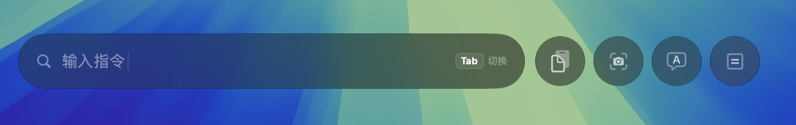
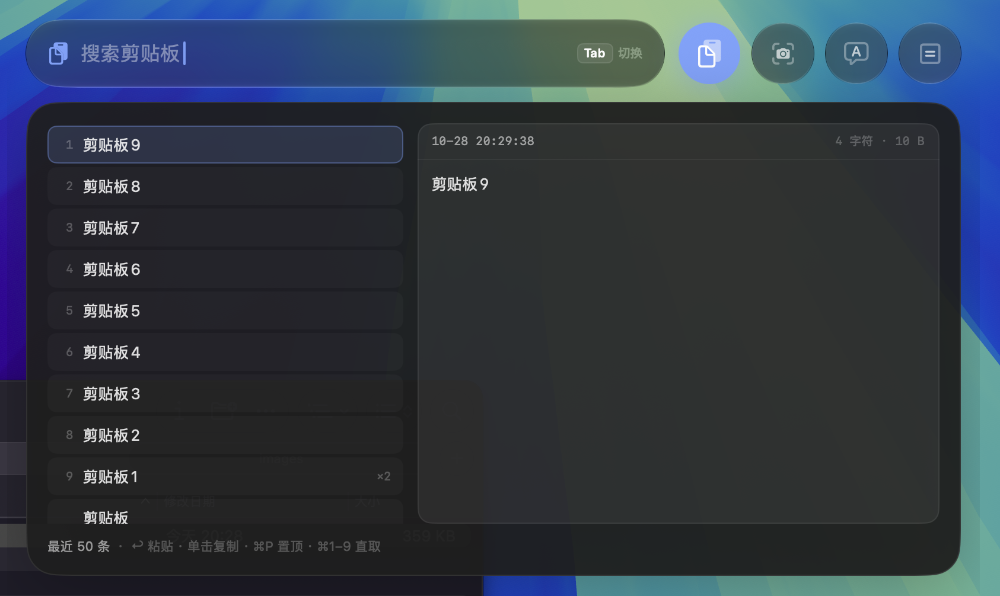
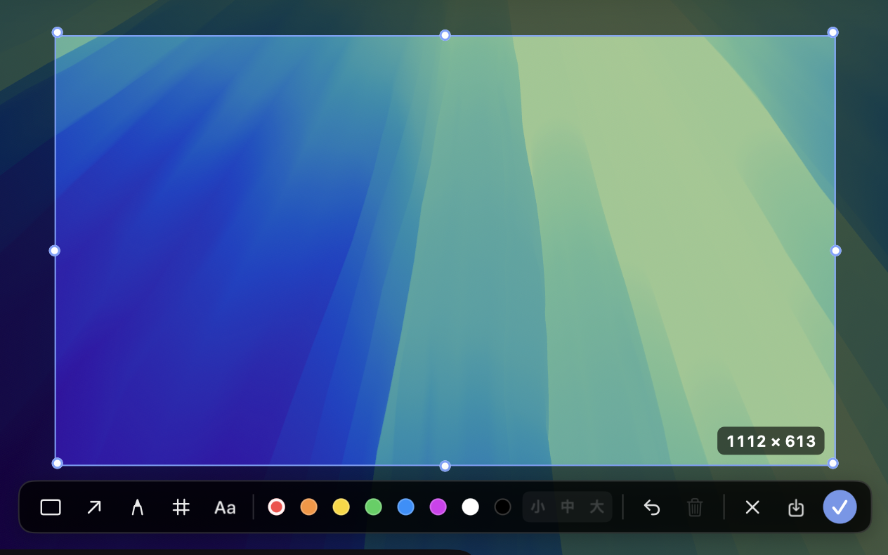
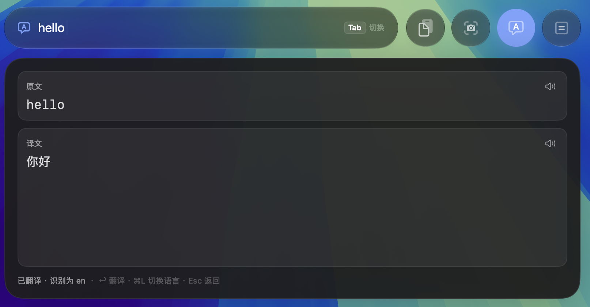
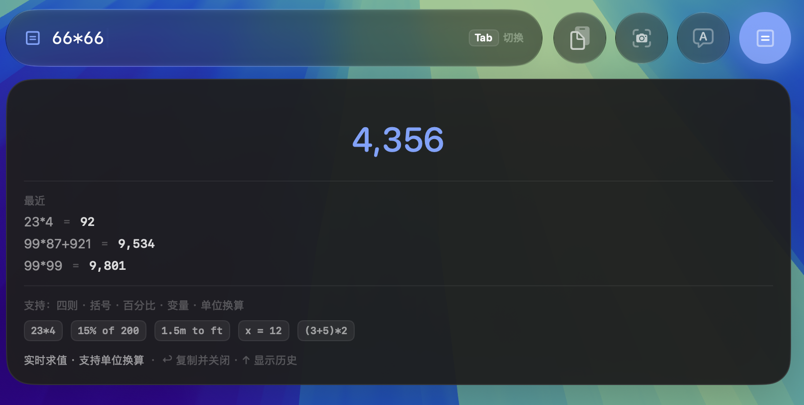

<div align="center">

# MacTools

**一个 ⌥Space 唤起、纯键盘驱动的 macOS 菜单栏工具集**

剪贴板历史 · 区域截图标注 · 划词翻译 · 自然语言计算器

[](#系统要求)
[](#技术栈)
[](LICENSE)



</div>

## 它是什么

菜单栏常驻，没有 Dock 图标，也没有主窗口。按下 `⌥Space`，屏幕顶部会落下一条窄窄的工具条：左侧输入框，右侧四个圆形按钮。四个模块（剪贴板 / 截图 / 翻译 / 计算器）共用同一个输入框、同一套键盘语义——`Tab` 循环切换，输入框的含义随激活的模块改变。常用的那个可以设为默认，之后按 `⌥Space` 直接落在它上面（设置 → 通用）。

浮窗是**非激活面板**：唤起时不抢走当前应用的焦点，关闭后也不用「还」焦点给谁。设计目标是让查剪贴板、算个数、翻一句话这类动作在两秒内完成，并且完全不打断手上的工作。

所有数据落在本地一个 SQLite 文件里，除了你主动配置的翻译接口之外不产生任何网络请求，没有遥测。

## 功能

### 剪贴板历史



- 0.25 秒轮询，靠 `changeCount` 门禁——内容没变时不读剪贴板，空闲时几乎不占 CPU
- SHA-256 去重、FTS5 全文检索（中文自动回退 `LIKE`）、容量按「保留置顶项」淘汰，默认保留 1000 条
- `↑` `↓` 选择，`⌘1`–`⌘9` 直取第 n 条，`⌘P` 置顶，`↩` 直接粘贴到前台应用
- 鼠标移到条目上，右侧实时预览全文；单击条目即复制并收起浮窗

### 区域截图与标注



- 用 ScreenCaptureKit 冻结整屏，保留 Retina 物理像素（不是 1x 糊图）
- 拖选、松手即固定在原位置标注：矩形 / 箭头 / 画笔 / 马赛克 / 文字
- 标注元素可二次编辑——拖动移动、拖八个手柄改大小、双击改文字、`⌫` 删除
- 默认不激活任何工具，此时拖选区内部移动、拖四边四角改大小；右下角常显截图分辨率
- 标注画布用 AppKit 直绘而非 SwiftUI `Canvas`，保证拖拽落点与画面同帧

### 划词翻译



- 任意应用里选中文本，按 `⌥T` 直接翻译
- 取词三级回退：辅助功能 AX → AppleScript → 模拟 `⌘C`
- 百度 / 有道双引擎，自动识别源语言，`⌘L` 循环切换目标语言
- 原文与译文卡片右上角各有一个朗读按钮
- 最近 10 条翻译自动留档，`↑` 翻阅；`↩` 不是回填输入框，而是把译文直接打进当前光标处

### 计算器



- SoulverCore 驱动，边输入边出结果：四则、括号、百分比、变量、单位换算
- `↑` 调出历史（最多 10 条），`↩` 把结果直接键入到当前光标处
- 在工具条输入 `=23*4` 可以越过切换动作、直接进计算器

## 快捷键

全局（可在「设置 → 通用」重新录制，带冲突检测）：

| 动作 | 默认快捷键 |
| --- | --- |
| 唤起 / 收起浮窗 | `⌥Space` |
| 打开剪贴板 | 未绑定 |
| 打开计算器 | 未绑定 |
| 区域截图 | `⌥⇧4` |
| 划词翻译 | `⌥T` |

「打开剪贴板 / 计算器」是直达入口，默认留空由你自行录制——每个人的习惯键位不一样，预设一个反而容易和别的软件撞上。

浮窗内：

| 位置 | 按键 |
| --- | --- |
| 工具条 | `Tab` / `⇧Tab` 循环切换，`⌘1`–`⌘4` 直达，`←` `→` 也可循环 |
| 输入框 | 输入 `cb` / `clip` / `sc` / `shot` / `tr` / `fy` / `=` 全文命中即直达对应模块 |
| 任意位置 | `Esc` 已激活时退回工具条，未激活时关闭浮窗 |
| 剪贴板 | `↑` `↓` 选择，`⌘1`–`⌘9` 直取，`⌘P` 置顶，`↩` 粘贴 |
| 计算器 | 直接输入表达式，`↑` 进历史，`↩` 键入结果 |
| 翻译 | `↩` 翻译（有译文时改为键入），`↑` 进历史，`⌘L` 切换目标语言 |
| 截图 | 激活后 `↩` 开始截图；标注时 `r` `a` `p` `m` `t` 切工具，`⌘Z` 撤销，`⌫` 删除，`↩` / `⌘C` 复制，`⌘S` 保存，`Esc` 取消 |

## 安装

没有预编译的发布包，需要自行从源码构建。

```sh
git clone https://github.com/jacksonrick/MacTools.git
cd MacTools

./scripts/make-signing-identity.sh   # 一次性：本地自签代码签名身份（强烈建议，见下文）
./scripts/build.sh Release           # 编译 Release
./scripts/install.sh Release         # 复制到 /Applications、重签、经 LaunchServices 启动
```

只想快速试一下也可以 `./scripts/build.sh && open build/Build/Products/Debug/MacTools.app`，但这种方式拿不到稳定的权限授权（原因见下一节）。

### 系统要求

- macOS 26.0 及以上
- Xcode 26 及以上（Swift 6.0，严格并发检查 `complete`）
- Apple Silicon（当前工程只构建 arm64）

### 技术栈

SwiftUI + AppKit 混编，[GRDB.swift](https://github.com/groue/GRDB.swift) 7.11 提供单库存储与 FTS5，[SoulverCore](https://github.com/soulverteam/SoulverCore) 2.7 负责表达式求值，截图走 ScreenCaptureKit，全局热键走 Carbon。

## 权限

需要三项系统权限，都只在对应功能首次使用时才申请：

| 权限 | 用途 | 不授权时的降级 |
| --- | --- | --- |
| 辅助功能 | 合成 `⌘V` 自动粘贴、读取其他应用的选中文本 | 粘贴变为「已复制」；`⌥T` 提示未授权并直接打开设置页 |
| 屏幕录制 | 区域截图 | 无法截图 |
| 自动化（AppleScript） | 取词的第二级回退 | 自动落到第三级 `⌘C` |

### 为什么「授权了还是提示要授权」

这是 macOS TCC 的签名机制导致的，不是 bug。ad-hoc 签名的「指定要求」里只有 CDHash，而这个值**每次重新构建都会变**——系统于是把新构建当成另一个 App，之前的授权自然作废。

`scripts/make-signing-identity.sh` 会生成一个本地自签的代码签名身份（`MacTools Dev`，有效期十年，存在登录钥匙串里），`install.sh` 会自动优先使用它。签名后的指定要求变成：

```
ad-hoc：   designated => cdhash H"7679dc26…"                        ← 每次构建都变
自签名：   designated => identifier "dev.mactools.MacTools"
                         and certificate root = H"cd97537a…"        ← 与内容无关，稳定
```

于是重复构建 / 重装都不会再让授权失效。**只有更换证书时**才需要重新授权一次。

另外两点容易踩的：

- 从终端直接跑 `Contents/MacOS/MacTools`，TCC 会把权限记在**终端**名下——看着能用，换成 Finder 双击就没有。用 `install.sh` 或 `open` 启动。
- 屏幕录制的授权只对**新启动的进程**生效。勾选后如果仍然不能用，退出重开一次。

自签证书不在系统信任链里，`security find-identity -v` 会显示 `CSSMERR_TP_NOT_TRUSTED`，这是正常的：签名和 `codesign --verify` 校验都不要求系统信任。但它**过不了 Gatekeeper**，所以本项目不适合直接分发给别人——正式分发需要开发者证书、Hardened Runtime 与公证。

## 数据与隐私

所有数据与设置只落一个文件：`~/Library/Application Support/MacTools/settings.sqlite`

| 表 | 内容 |
| --- | --- |
| `clips` / `clips_fts` | 剪贴板内容与 FTS5 全文索引 |
| `kv` | 设置、计算历史、翻译历史、翻译凭据 |

数据库以 WAL 模式打开，目录权限 `0700`，库文件与 `-wal` / `-shm` 均为 `0600`。截图文件按常规落在 `~/Pictures/Screenshots/`（目录可改）。

翻译凭据以明文存在数据库里，依赖文件权限保护——如果你更希望隔离，可以把 `TranslationService` 的读写改回 `KeychainStore`。

本项目不做敏感内容过滤，剪贴板内容原样入库；容量与单条上限可在设置中调整。除翻译接口外无任何网络请求，无遥测。

## 项目结构

```
MacTools/
  App/            入口、AppDelegate、依赖容器、DEBUG 自检
  Core/
    Panel/        浮窗、路由器、位置计算、隐形输入框、顶部工具条
    Hotkey/       Carbon 全局热键、快捷键录制、开机自启
    Settings/     设置存储与五个设置页
    Permissions/  权限协调、⌘V 合成粘贴
    Storage/      单库（clips + kv）、计算历史、旧数据搬迁
  DesignSystem/   动效常量、玻璃材质、字体
  Modules/
    Shared/       功能卡片、键帽、占位视图
    Clipboard/    监听、列表、预览
    Screenshot/   冻结整屏、选区覆盖层、标注画布、工具条
    Translation/  双引擎 Provider、取词服务、TTS
    Calculator/   SoulverCore 引擎与视图
  Resources/      Assets.xcassets（AppIcon / AccentColor）
Config/           签名 entitlements
scripts/          build.sh / install.sh / selftest.sh / make-signing-identity.sh
```

## 开发

自检不需要人工点击，直接驱动 `HUDRouter`、各 Store、剪贴板监听、标注命中与合成、窗口焦点，逐条打印断言：

```sh
./scripts/build.sh Debug && ./scripts/selftest.sh
# === SELFTEST PASSED (182/182) ===
```

没有屏幕录制与辅助功能权限也能跑通——真实截屏、`⌘V` 合成、在线 TTS 这几条路径按权限状态分支断言。

调试钩子（仅 DEBUG 生效）通过环境变量开启，例如把某个界面状态直接渲染成 PNG：

```sh
MACTOOLS_DEBUG_SNAPSHOT=/tmp/hud.png \
MACTOOLS_DEBUG_SNAPSHOT_STATE=clipboard \
open -n build/Build/Products/Debug/MacTools.app
```

可用的状态有 `bar` / `clipboard` / `translation` / `calculator` / `screenshot` / `annotate` / `settings`。另有 `MACTOOLS_DEBUG_FLOW` 系列用于复现截图链路的时序问题，`MACTOOLS_DEBUG_TRACE=1` 打开诊断日志（默认这些日志连字符串都不会拼出来，Release 里更是不落地）。

## 已知限制

- 面板固定 820×540，不做运行时缩放
- 汇率换算暂时下线；命中跨币种写法时会明确提示「暂不支持汇率换算」，而不是按 1:1 静默给出错误结果
- 截图流程是微信 / 钉钉式的「松手即就地标注」，不另开标注窗口，也不中转缩略图
- 按设计明确排除：插件系统、OCR、滚动长截图、自动更新、敏感内容过滤
- 沙盒关闭（需要读其他应用的选中文本、写 `~/Pictures`），Hardened Runtime 开启，并保留 `disable-library-validation`——SoulverCore 以二进制 XCFramework 分发且签名方不同，不关掉库校验 `dlopen` 会失败

## 许可证

[MIT](LICENSE)
